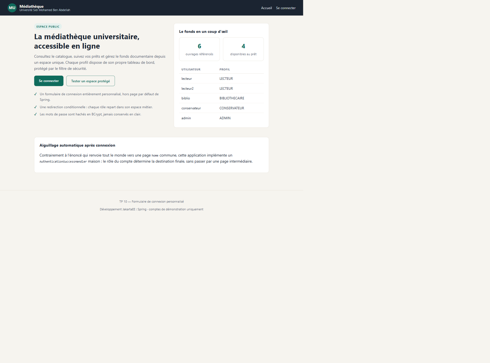
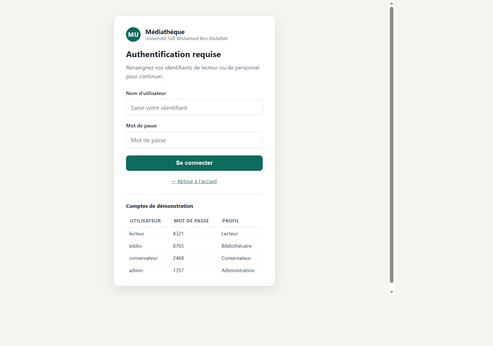
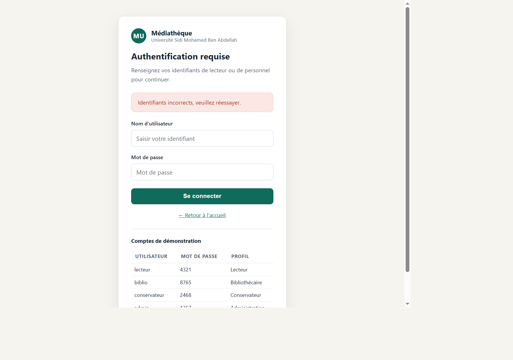
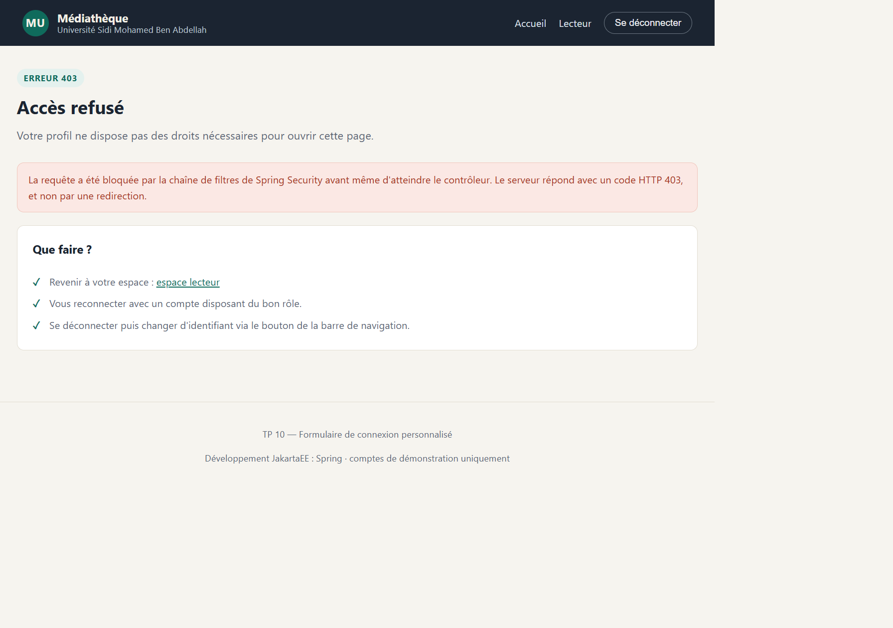
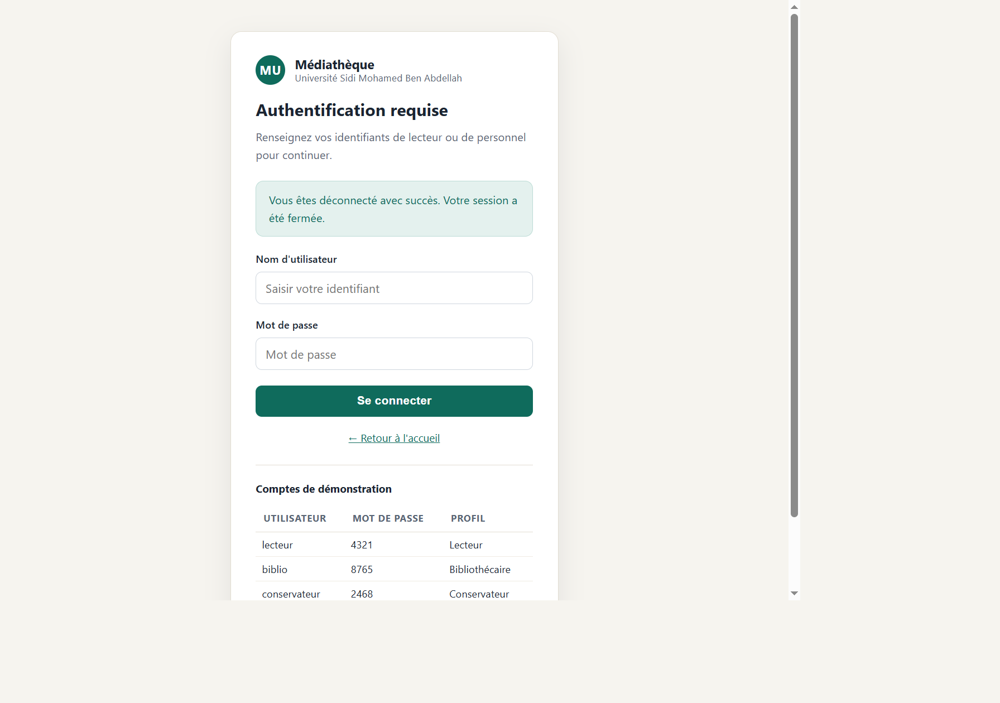
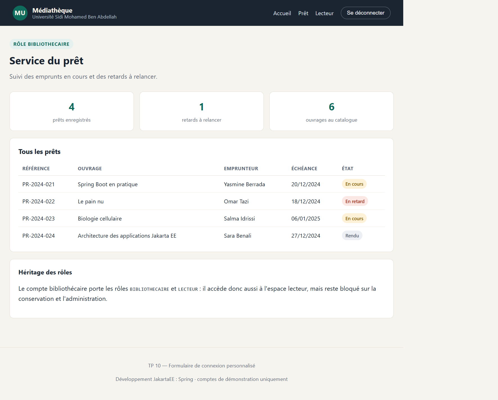
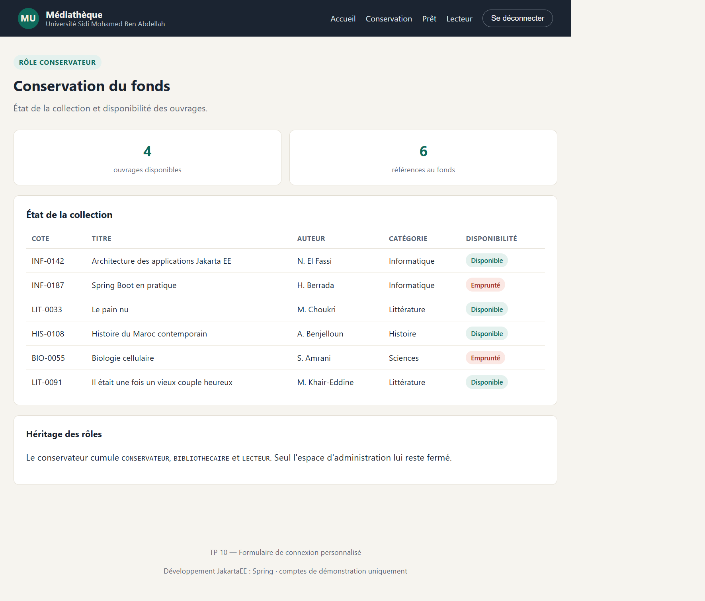
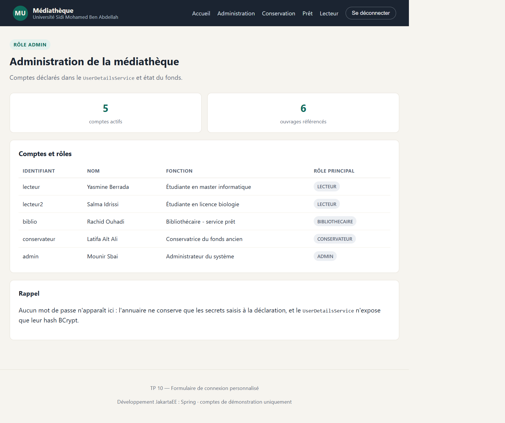

# TP 10 — Formulaire de connexion personnalisé


## Comptes de démonstration

- `lecteur` / `4321` — Yasmine Berrada, étudiante en master informatique, rôle LECTEUR
- `lecteur2` / `9753` — Salma Idrissi, étudiante en licence biologie, rôle LECTEUR
- `biblio` / `8765` — Rachid Ouhadi, bibliothécaire au service du prêt, rôle BIBLIOTHECAIRE
- `conservateur` / `2468` — Latifa Aït Ali, conservatrice du fonds ancien, rôle CONSERVATEUR
- `admin` / `1357` — Mounir Sbai, administrateur du système, rôle ADMIN

Les secrets n'existent en clair que dans l'annuaire de déclaration : au démarrage, ils sont encodés en BCrypt et seul le hash est conservé en mémoire par le `UserDetailsService`.

## Prérequis

JDK 21, Maven 3.9 ou supérieur. Aucune base de données n'est nécessaire, tout tient en mémoire et se réinitialise à chaque redémarrage.

Pour lancer l'application :

```
mvn spring-boot:run
```

L'application écoute ensuite sur `http://localhost:8080`.

## Résultats obtenus

### Page d'accueil publique



La racine du site est accessible sans authentification. Un visiteur anonyme ne voit que les liens « Accueil » et « Se connecter » : les entrées des espaces métier et le bouton de déconnexion n'apparaissent qu'une fois la session ouverte.

### Redirection vers la connexion



Une requête sur `/espace/lecteur/tableau-de-bord` sans session valide est interceptée par le filtre de sécurité et renvoyée vers le formulaire personnalisé. Le visiteur ne voit jamais la page de connexion générée par Spring.

### Refus d'un mot de passe erroné



L'identifiant `lecteur` accompagné du mot de passe `mauvais` renvoie sur `/connexion?erreur=true`. Le message reste volontairement générique : il ne précise jamais si c'est l'identifiant ou le mot de passe qui est en cause.

### Espace lecteur après connexion


La connexion de `lecteur` aboutit directement sur `/espace/lecteur/tableau-de-bord` grâce au gestionnaire de succès. La page salue la lectrice par son nom, affiche ses seuls prêts et rappelle le périmètre réel du profil, à savoir que les trois autres espaces lui sont fermés.

### Accès refusé pour un rôle insuffisant



Toujours connecté en tant que lecteur, l'appel à `/espace/administration/tableau-de-bord` est bloqué par la chaîne de filtres avant même d'atteindre le contrôleur. La réponse HTTP est bien un 403, pas une redirection, et la page d'erreur affichée est une template Thymeleaf déclarée via `accessDeniedPage`.

### Déconnexion



Le bouton de déconnexion de la barre de navigation envoie un POST sur `/deconnexion`. La session est invalidée, le cookie supprimé, puis l'utilisateur revient sur le formulaire avec le message de confirmation.

### Espace bibliothécaire



Le compte `biblio` est aiguillé vers le service du prêt, où il retrouve l'ensemble des emprunts avec les retards à relancer. La barre de navigation s'adapte au rôle : les entrées « Prêt » et « Lecteur » apparaissent, les autres non.

### Espace conservation



Le compte `conservateur` arrive sur l'état du fonds documentaire. Son menu cumule les trois niveaux de droits, puisque le rôle CONSERVATEUR hérite de BIBLIOTHECAIRE et de LECTEUR.

### Espace administration



Le compte `admin` voit en plus la liste des comptes réellement déclarés dans le `UserDetailsService`, avec leur rôle principal. Aucun mot de passe n'y figure : seul le hash BCrypt est conservé côté serveur.

## Choix d'implémentation

Le contrôle d'accès tient dans une `SecurityFilterChain` unique, avec des règles ordonnées du plus spécifique au plus général et `anyRequest().authenticated()` en dernier recours. Les URL de connexion, de traitement et de déconnexion sont toutes personnalisées, ainsi que les noms des champs du formulaire : `identifiant` et `motDePasse` remplacent les `username` et `password` par défaut.

Les comptes sont décrits dans un annuaire métier (`AnnuaireLecteurs`) puis convertis en objets `User` par le `UserDetailsService`. Les rôles sont attribués de façon cumulative à partir d'une liste ordonnée, ce qui garde la hiérarchie lisible et évite de répéter les habilitations pour chaque compte.

La partie la plus intéressante du TP est la redirection après succès. L'énoncé utilise `defaultSuccessUrl("/home", true)` avec une page commune, ce qui oblige la vue à décider quoi montrer selon le rôle. Ici, un `AuthenticationSuccessHandler` dédié (`RedirectionParRole`) inspecte les autorités du compte avant de construire la redirection : administration, conservation, prêt ou lecteur, dans cet ordre de priorité. Aucune page intermédiaire n'est nécessaire et la logique reste dans la couche de sécurité.

Le formulaire lui-même ne contient aucune logique : il se contente d'afficher trois messages possibles (erreur, déconnexion, session expirée) et de poster les deux champs attendus. Le jeton CSRF est injecté automatiquement par Spring Security, sans champ caché à écrire à la main.


